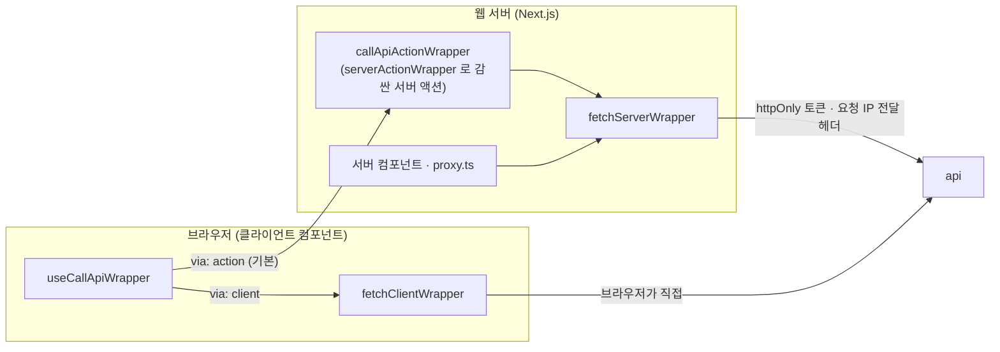

# 파일 관리 서비스

파일을 업로드하고 외부 공유 링크를 만들고 버전 관리를 할 수 있는 기능을 제공합니다.

## 빠른 실행

Docker (Compose v2) 와 Node.js 가 설치돼 있다고 가정합니다.

```bash
git clone https://github.com/wisdomstar94/file-management-service.git
cd file-management-service
cp .env.local-sample .env.local      # Windows: copy .env.local-sample .env.local
corepack enable                      # package.json 의 packageManager 버전(yarn 4)을 씁니다
yarn install
yarn docker:up:all:local
```

| 화면 | 주소 | 비고 |
| --- | --- | --- |
| 관리자 웹 | http://localhost:3000 | 아이디 `admin` · 비밀번호 `admin1234!` |
| 공개 링크 웹 | `http://localhost:3001/s/<shareLinkKey>` | 관리자 웹에서 만든 외부 공개 링크로 열립니다 |
| API 상태 확인 | http://localhost:4000/api/health | `{"data":{"status":"ok"}}` |

종료는 `yarn docker:down:all:local` 입니다. 업로드 파일 · DB 데이터까지 지우려면 `yarn docker:down:all:local -v` 로 실행합니다.

- Node.js 25 부터는 corepack 이 함께 설치되지 않습니다. `corepack enable` 이 없다고 나오면 `npm install -g corepack` 을 먼저 실행하세요.
- 로컬 개발용 postgres(`dockers/compose.postgres.yml`)와 같은 compose 프로젝트(`fms`)라 컨테이너 · 볼륨을 함께 씁니다.
- Node · yarn 없이 Docker 만으로 띄우는 방법, 로컬 개발, 서비스별 도커 · node 실행, env 설정, 운영 시 주의 사항은 [`docs/run-and-operation-guide.md`](docs/run-and-operation-guide.md) 에 있습니다.

---

## 설계 의도

아래는 이 저장소의 구조를 **왜 이렇게 잡았는지** 를 적은 것입니다. 무엇을 어떻게 실행하는지는 위 안내 문서를 보세요.

### 1. 저장소 구성

| 경로 | 역할 |
| --- | --- |
| `servers/api` | Express API. `/api/admin/**` 는 관리자, `/api/public/**` 는 외부 공개 링크 |
| `servers/database-manager` | TypeORM 마이그레이션 · 시드 CLI |
| `webs/file-management-service-admin` | 관리자 웹 (Next.js) |
| `webs/file-management-service-user` | 외부 공개 링크 웹 (Next.js) |
| `libs/**` | 앱끼리 함께 쓰는 패키지 |

libs 는 기능이 아니라 **어디서 실행되는가** 를 기준으로 나눴습니다.

| 그룹 | 쓰는 곳 | 예 |
| --- | --- | --- |
| `libs/common-shared` | 서버 · 웹 모두 | `api-schemas` · `consts` · `types` · `error-provider` · `jwt-handler` |
| `libs/server-shared` | 서버만 | `database-entities` · `password-handler` · `server-utils` |
| `libs/web-shared` | 웹만 | `web-ui` · `web-utils` |
| `libs/internal` | 개발 도구 | `biome-config` |

패키지 이름만 보고도 "이걸 웹에서 import 해도 되는가" 를 알 수 있게 하기 위해서입니다. DB 엔티티나 비밀번호 해시 코드가 웹 번들에 섞여 들어가는 실수를 구조로 막습니다.

### 2. libs 는 서브패스 단위로 빌드합니다

libs 패키지는 하나의 `index` 로 묶지 않고 모듈마다 진입점을 둡니다.

```ts
import { API_ERROR_CODE } from "@fms/consts/errors/api-error-code";
import { DOCUMENT_LIST_API } from "@fms/api-schemas/schemas/document-api-schemas";
```

- `scripts/collect-entries.mjs` 가 `src/` 아래에서 `index.ts` 를 가진 폴더를 찾아 진입점 목록을 **폴더 구조에서 만듭니다.** 진입점을 손으로 나열하지 않으므로, 폴더를 추가하면 곧바로 `@fms/<패키지>/<그룹>/<모듈>` 로 import 할 수 있습니다.
- `scripts/create-lib-vite-config.mjs` 가 진입점마다 `dist/<그룹>/<모듈>/index.{mjs,cjs,d.ts}` 를 만듭니다. 패키지 전체가 하나의 파일로 번들되지 않아, 쓰는 모듈만 가져옵니다.
- `_` 로 시작하는 폴더는 진입점에서 빠집니다. 패키지 안에서만 쓰는 구현은 외부에 공개되지 않습니다.
- 하나의 거대한 배럴이 없으므로, `"use client"` 가 필요한 모듈과 서버 전용 모듈이 같은 import 경로에 섞여 Next.js 의 서버 · 클라이언트 경계가 깨지는 일이 없습니다.

### 3. 카테고리 폴더 구조

모든 앱과 libs 는 같은 폴더 규칙을 따릅니다.

```text
documents-router/                 <-- 카테고리 폴더: /api/admin/documents api 를 처리하는 라우터
  ㄴ _services/                   <-- 그룹핑 폴더: documents-router 안에서만 쓰는 것
    ㄴ list-documents/            <-- 서브 카테고리 폴더
      ㄴ index.ts                 <-- export * from "./list-documents.js"
      ㄴ list-documents.ts        <-- listDocuments 함수 하나만
  ㄴ _utils/
    ㄴ to-document-detail-response/
  ㄴ versions-router/             <-- 하위 라우터: /api/admin/documents/:documentId/versions api 를 처리
  ㄴ share-links-router/          <-- 하위 라우터: /api/admin/documents/:documentId/share-links api 를 처리
  ㄴ index.ts
  ㄴ documents-router.ts
```

규칙은 네 가지입니다.

1. **폴더 하나에는 관심사 하나, 파일 하나에는 export 하는 선언(컴포넌트 · 함수 · 타입 등) 하나만 둡니다.** 예를 들어 `list-documents/list-documents.ts` 에는 `listDocuments` 함수 하나만 있습니다. 폴더 이름 · 파일 이름 · 선언 이름이 같습니다. 한 파일은 200줄을 넘기지 않고, 넘으면 서브 카테고리로 나눕니다.
2. **`_` 로 시작하는 그룹핑 폴더는 "이 카테고리 안에서만 쓴다" 는 표시입니다.** `_components` · `_utils` · `_services` · `_types` · `_consts` 등을 씁니다.
3. **코드는 사용처 가까이에 둡니다.** 쓰는 곳이 한 곳이면 그 옆의 `_<종류>/` 에, 두 곳 이상이 되면 `src/components` · `src/utils` 같은 공용 폴더로 올립니다. 공용 폴더 안에서는 범용 코드를 `commons/`, 특정 업무 영역 코드를 `domains/` 로 나눕니다.
4. **배럴 export 는 카테고리 폴더 자신의 `index.ts` 에서만 합니다.** 여러 카테고리를 모아 내보내는 `index.ts` 는 두지 않습니다.

이렇게 정한 이유는 다음과 같습니다.

- **경로만 보고 영향 범위를 알 수 있습니다.** `_` 폴더 안의 코드를 고치면 바깥에는 영향이 없다는 것이 보장됩니다. 공용 폴더의 코드를 고칠 때만 사용처를 찾아보면 됩니다.
- **지우고 옮기기가 쉽습니다.** 기능 하나가 폴더 하나에 모여 있어, 화면이나 라우터를 지울 때 폴더째 지우면 그 기능만 쓰던 코드가 남지 않습니다.
- **파일을 찾는 데 규칙이 하나뿐입니다.** 선언 이름을 알면 파일 위치를 알 수 있습니다. 사람이든 AI 에이전트든 저장소 전체를 읽지 않고도 필요한 파일에 닿을 수 있습니다.
- **거대한 배럴과 순환 참조가 생기지 않습니다.** 모든 import 가 실제 모듈 경로를 가리키므로 의존 관계가 그대로 드러납니다.

예시는 저장소 곳곳에 있습니다.

- 라우트 폴더에서만 쓰는 화면 컴포넌트: `webs/file-management-service-admin/src/app/(auth-required)/documents/_components/documents-screen`
- `proxy.ts` 에서만 쓰는 함수: `webs/file-management-service-admin/src/_utils/read-route-group`
- 두 화면에서 쓰는 편집기: `webs/file-management-service-admin/src/components/domains/access-policy-groups/access-policy-group-editor`
- api 라우터 폴더가 겹쳐 들어가는 모양이 URL 경로와 같습니다. `servers/api/src/routes/api-router/admin-router/documents-router/versions-router` 는 `/api/admin/documents/:documentId/versions` 를 처리하므로, URL 만 보고 라우터 파일을 찾을 수 있습니다

규칙 일부는 lint 로 검사합니다. 예를 들어 `libs/internal/biome-config/src/no-derived-alias.grit` 는 `type PermissionCode = keyof typeof PERMISSION_CODE_REGISTRY` 처럼 다른 상수 · 타입에 이름만 다시 붙인 별칭을 막습니다. 원본을 찾으려고 별칭을 따라가야 하는 일을 없애기 위해서입니다.

### 4. api 스펙은 `@fms/api-schemas` 한 곳에서 정의합니다

api 하나는 schema 객체 하나로 정의합니다.

```ts
export const DOCUMENT_LIST_API = {
  url: "/api/admin/documents",
  method: "GET",
  request: {
    params: typeOf<undefined>(),
    headers: typeOf<undefined>(),
    body: typeOf<undefined>(),
    query: typeOf<{ page?: number; size?: number; keyword?: string; createdWithinDays?: number }>(),
  },
  response: typeOf<ApiSuccessBody<{ items: DocumentSummary[]; total: number; page: number; size: number }>>(),
  tags: ["documents"],
} as const satisfies ApiSchema;
```

- `request` · `response` 의 값은 의미가 없고 **타입만** 싣습니다(`typeOf<T>()` 는 항상 `undefined`). 그래서 schema 를 웹 번들에 넣어도 부담이 없습니다.
- **api 서버** 는 응답을 만들 때 `ResBody<typeof DOCUMENT_LIST_API>` 로 타입을 맞춥니다. 응답 모양이 schema 와 다르면 api 쪽에서 타입 에러가 납니다.
- **웹** 은 url 문자열을 직접 쓰지 않고 schema 를 호출 래퍼에 넘깁니다. 경로 변수 · 쿼리 · 본문 · 응답 타입이 모두 schema 에서 추론됩니다.
- 런타임 요청 검증은 schema 가 아니라 api 의 `servers/api/src/validators` (zod) 가 맡습니다. 브라우저가 보낸 값은 타입과 상관없이 믿을 수 없기 때문입니다.
- 응답은 성공이면 `{ data }`, 실패면 `{ error: { code, message, details? } }` 로 통일합니다. api 의 `parseRequest` · `HttpError` · 전역 에러 미들웨어가 이 규격을 만들고, 웹은 `error.code` (`@fms/consts/errors/api-error-code`) 로 분기합니다.

결과적으로 url · 요청 · 응답의 정의가 한 곳뿐이라, api 를 바꾸면 그 api 를 쓰는 서버 · 웹 코드가 모두 타입 검사에서 드러납니다.

### 5. 웹의 api 호출 구조

웹은 `fetch` 를 직접 쓰지 않고 `src/wrappers` 의 래퍼를 통해서만 api 를 호출합니다. 래퍼는 **어디서 호출하느냐** 에 따라 나뉩니다. 아래는 관리자 웹 기준입니다.



| 래퍼 | 쓰는 곳 | 하는 일 |
| --- | --- | --- |
| `fetchServerWrapper` | 서버 컴포넌트 · 서버 액션 · `proxy.ts` | 쿠키의 access token 과 요청 IP 전달 헤더를 붙여 api 를 호출합니다. 401 · 접근 정책 거부 · 권한 없음 · 404 는 로그인 · 거부 · forbidden · not-found 화면으로 이동시킵니다 |
| `serverActionWrapper` | 모든 서버 액션 | 던져진 에러를 `CommonError` 로 바꿔 **return** 합니다. `redirect()` · `notFound()` 는 다시 던져 이동이 동작하게 합니다 |
| `callApiActionWrapper` | 클라이언트 → 서버 액션 | 클라이언트 컴포넌트가 schema 로 api 를 호출하는 서버 액션입니다. 화면 이동 대신 에러를 돌려줘 호출한 쪽이 메시지로 보여줍니다 |
| `fetchClientWrapper` | 브라우저 → api 직접 | 웹 서버를 거치지 않고 api 를 호출합니다 |
| `useCallApiWrapper` | 클라이언트 컴포넌트 | 위 두 경로를 `via` 로 고르고, 로딩 · 에러 토스트 · 성공 메시지 · `router.refresh()` 를 한 곳에서 처리합니다 |

이렇게 나눈 이유는 다음과 같습니다.

- **토큰을 브라우저 JS 에 내놓지 않기 위해서입니다.** 관리자 access · refresh token 은 httpOnly 쿠키에만 있고, api 호출은 기본적으로 웹 서버가 대신 합니다(`via: "action"`). 클라이언트 코드는 토큰을 읽을 수도 다룰 수도 없습니다.
- **브라우저가 넘긴 schema 를 믿지 않습니다.** 서버 액션은 브라우저에서 아무 인자로나 호출할 수 있으므로, `callApiActionWrapper` 는 `assertCallableSchema` 로 `/api/admin/**` 경로 · json 응답 · 임의 헤더 없음만 허용하고, 토큰을 주고받는 인증 api 는 막습니다. 웹 서버가 임의 url 로 요청을 대신 보내 주는 통로가 되지 않게 하기 위해서입니다.
- **브라우저 직접 호출은 꼭 필요한 경우로 좁혔습니다.** api 가 직접 쿠키를 심어야 하는 로그인 · 로그아웃 · 공개 링크 잠금 해제 · 다운로드, 그리고 큰 파일을 웹 서버를 거치지 않고 올리는 업로드입니다. 업로드는 서버 액션으로 받아 둔 수명이 짧은 short-time token 을 `authorization` 헤더에 담아 보냅니다. 그래서 브라우저가 api 를 호출하더라도 긴 수명의 토큰은 여전히 노출되지 않습니다.
- **에러 규격을 하나로 맞췄습니다.** 서버 액션은 경계를 넘을 때 에러 객체를 그대로 전달하지 못하므로, 모든 에러를 plain object 인 `CommonError` (`@fms/error-provider`) 로 바꿉니다. 호출하는 쪽은 경로와 상관없이 `isCommonError(result)` 하나로 성공 · 실패를 나눕니다.
- **호출 코드가 짧아집니다.** 화면 코드는 schema 와 요청 값만 넘기면 됩니다.

```tsx
// 서버 컴포넌트
const documents = await fetchServerWrapper(DOCUMENT_LIST_API, { query });

// 클라이언트 컴포넌트
const deleteApi = useCallApiWrapper(DELETE_ADMIN_ACCOUNT_API, { successMessage: "삭제했습니다" });
await deleteApi.fetchApi({ params: { id: account.id } });
```

공개 링크 웹도 같은 이름 · 같은 모양의 래퍼를 자기 `src/wrappers` 에 둡니다. 다만 관리자 토큰을 붙이거나 로그인 · forbidden 화면으로 이동시키는 동작이 없는 등 앱마다 하는 일이 달라, 공용 패키지로 묶지 않고 앱 안에 둡니다.

### 6. 관리자 인증은 웹 서버(BFF)가 맡습니다

- 관리자 웹의 `proxy.ts` 가 모든 요청 앞에서 토큰 쿠키를 확인하고, access token 이 만료됐거나 곧 만료되면 refresh token 으로 갱신해 쿠키를 다시 씁니다. 화면 코드는 로그인 상태를 신경 쓰지 않습니다.
- 화면은 route group 으로 `(guest-only)` · `(auth-required)` · `(public)` 을 나눕니다. `readRouteGroup` 은 목록에 없는 경로를 **로그인 필수로 봅니다.** 새 화면을 만들고 깜빡해도 로그인 없이 열리지 않게 하기 위해서입니다.
- 한 화면에서 여러 요청이 동시에 갱신을 시도할 때의 경합 처리는 [`docs/jwt-refresh-strategies.md`](docs/jwt-refresh-strategies.md) 에 케이스별로 정리했습니다.

### 7. 권한은 코드에서 정의합니다

- 권한 코드는 `libs/common-shared/consts/src/permissions/permission-code-registry` 의 `PERMISSION_CODE_REGISTRY` 에만 있습니다. api 는 `requirePermission(<코드>)` 로, 관리자 웹은 `hasPermission(<코드>)` · `requirePagePermission(<코드>)` 로 검사합니다.
- 관리자 화면에서는 권한을 만들 수 없고 분류 · 이름 · 설명만 바꿀 수 있습니다. **코드가 검사하지 않는 권한은 의미가 없기 때문** 입니다. 시드는 레지스트리에 있는데 DB 에 없는 권한만 추가합니다.
- 권한 코드가 타입으로 정해져 있어, 없는 코드를 검사하면 타입 에러가 납니다.

### 8. 요청 IP 는 신뢰할 수 있는 경로로만 받습니다

관리자마다 IP · 요청 헤더 기반 접근 정책을 걸 수 있으므로, 요청 IP 를 위조할 수 없어야 합니다.

- 브라우저 → 웹 서버 → api 로 요청이 넘어갈 때, 웹 서버는 `fetchServerWrapper` 에서 원래 요청 IP 를 전달 헤더로 붙이되 **호출하는 쪽이 넘긴 헤더보다 나중에 덮어써** 바꿀 수 없게 합니다.
- api 는 웹 컨테이너의 고정 IP 만 프록시로 신뢰합니다(`API_TRUST_PROXY`). 브라우저가 api 를 직접 호출하며 `X-Forwarded-For` 를 보내도 무시됩니다.
- 웹 서버 앞에는 헤더를 덮어쓰는 리버스 프록시를 두고 `WEB_TRUSTED_PROXY_HOPS` 로 그 수를 지정합니다.

### 9. 규칙은 문서가 아니라 스크립트로 지킵니다

사람이 기억해야 하는 규칙은 결국 어겨지므로, 가능한 것은 `yarn lint:check` · `yarn type:check` 에 넣었습니다.

| 검사 | 막는 것 |
| --- | --- |
| `scripts/check-migrations.mjs` | DB 마이그레이션 파일명의 timestamp 를 손으로 짓는 것. 마이그레이션은 TypeORM CLI(`migration:generate` · `migration:create`)로만 만들어, 파일명만 보고 언제 만든 것인지 알 수 있게 합니다 |
| `scripts/check-tailwind-classes.mjs` | 정규(canonical) 표기가 아닌 Tailwind 클래스. 에디터 경고와 같은 기준으로 검사합니다 |
| `no-derived-alias.grit` (biome) | 상수 · 타입에서 뽑은 별칭 |
| 앱별 `e2e/tsconfig.json` | e2e 코드가 타입 검사에서 빠지는 것 |

e2e 는 `yarn e2e` 로 격리된 도커 환경에서 api(jest) · 웹(playwright) 을 실제로 띄워 실행합니다.

---

## 더 보기

- [`docs/run-and-operation-guide.md`](docs/run-and-operation-guide.md) — 실행 · 로컬 개발 · 도커 · env · DB 마이그레이션 · 운영 시 주의
- [`docs/jwt-refresh-strategies.md`](docs/jwt-refresh-strategies.md) — access · refresh token 갱신 전략
- [`AGENTS.md`](AGENTS.md) — 작업 규칙
