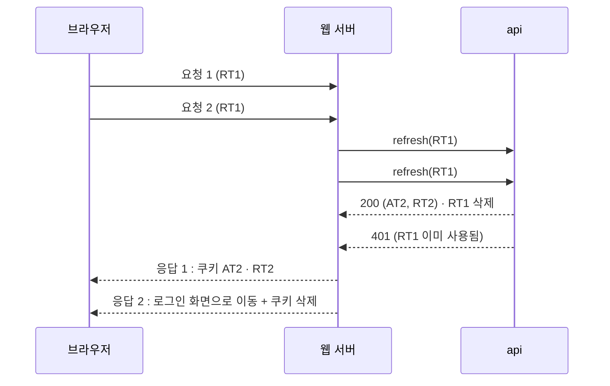

# JWT access · refresh token 갱신 전략

access token 을 refresh token 으로 갱신할 때 서버(api)가 refresh token 을 어떻게 다루느냐에 따라 생기는 문제와 해결 방법이 달라집니다. 이 문서는 케이스별로 **무엇이 문제인지 · 어디서(api · 웹 서버 · 브라우저) 어떻게 처리할 수 있는지 · 각 방법의 한계** 를 정리합니다.

마지막 절에 이 프로젝트가 실제로 고른 방식과 이유를 적었습니다.

## 용어

| 용어 | 뜻 |
| --- | --- |
| access token (AT) | api 호출에 쓰는 짧은 수명의 JWT. 서명 · 만료만 검사하므로 api 가 DB 를 보지 않고 검증한다 |
| refresh token (RT) | AT 를 새로 받는 데 쓰는 긴 수명의 토큰. 서버가 DB 에 저장 · 폐기한다 |
| rotation | 갱신할 때 RT 도 새로 발급하는 방식 |
| 계열(family) | 로그인 한 번으로 시작해 rotation 으로 이어진 RT 들의 묶음 |
| 웹 서버(BFF) | 브라우저와 api 사이에서 토큰을 쿠키로 다루는 서버. 이 프로젝트에서는 관리자 웹의 Next.js 서버(`proxy.ts`) |
| 경합 | 같은 RT 로 갱신 요청이 거의 동시에 2번 이상 api 에 가는 상황 |

## 경합은 언제 생기나

AT 가 만료되면 그 뒤 들어오는 요청은 모두 "갱신이 필요하다" 고 판단합니다. 아래 상황에서 이런 요청이 동시에 여러 개 생깁니다.

- 한 화면이 api 를 여러 개 병렬로 호출할 때
- Next.js 처럼 링크 프리페치 · RSC 요청이 한꺼번에 나갈 때
- 탭을 여러 개 띄워 두었다가 동시에 새로고침되거나 포커스될 때
- 오래 쉬다 돌아와 첫 화면을 열 때(AT 쿠키는 이미 만료돼 사라졌고 RT 만 남은 상태)

---

## case 1. rotation + 쓴 RT 즉시 재사용 불가

> 갱신하면 RT 도 새로 발급하고, 한 번 쓴 RT 는 서버가 바로 지운다(또는 무효 처리한다).
> 그런데 요청이 동시에 들어와 같은 RT 로 갱신 요청이 2번 이상 api 에 간다.

### 문제

- 늦게 처리된 요청이 401 을 받아 사용자가 로그인 화면으로 튕깁니다.
- 401 처리에서 쿠키를 지우면 먼저 받은 새 토큰까지 지워져 **완전히 로그아웃** 됩니다.
- 브라우저에 응답이 도착하는 순서는 보장되지 않아서, 재현이 어렵고 간헐적으로 생깁니다.

### 처리 방법

#### (1) api : 쓴 RT 를 잠깐 더 받아 주기 (유예 시간) → [case 4](#case-4-rotation--서버-유예-시간)

가장 확실하지만 api 를 고칠 수 있어야 합니다.

#### (2) 웹 서버 : 진행 중인 갱신 공유 + 짧은 결과 캐시

- RT 해시를 키로 하는 맵에 **진행 중인 갱신 Promise** 를 넣어 둡니다. 같은 RT 로 동시에 들어온 요청은 api 를 다시 부르지 않고 그 Promise 를 함께 기다립니다.
- 갱신이 끝난 뒤에도 결과(새 AT · RT)를 N초 동안 캐시합니다. 조금 늦게 도착한 요청이 옛 RT 를 들고 와도 캐시된 새 토큰을 받습니다.
- 모든 응답이 같은 새 쿠키를 심으므로, 브라우저에 어떤 순서로 도착해도 쿠키가 일관됩니다.

한계

- **웹 서버 프로세스 메모리** 에만 있어서, 웹 서버가 여러 대이고 요청이 다른 인스턴스로 나뉘면 막지 못합니다.
  - 로드밸런서 **sticky session** 으로 같은 브라우저를 같은 인스턴스로 보내면 됩니다. 코드 변경은 없지만 인스턴스가 재시작되거나 빠지면 그 순간엔 다시 생길 수 있습니다.
  - **Redis 같은 공유 저장소** 에 `SET NX` 로 갱신 담당을 하나만 정하고 결과를 TTL 로 저장하면 여러 대에서도 막힙니다. 대신 인프라가 하나 늘고, 락을 잡은 인스턴스가 죽었을 때 대기 · 타임아웃 처리를 해야 합니다.
- 새 토큰이 웹 서버 메모리(또는 Redis)에 N초 머뭅니다. 키는 RT 원문이 아니라 해시로 둡니다.
- 로그아웃 직후 N초 안에는 옛 RT 로 캐시된 토큰을 받을 수 있습니다. 로그아웃할 때 캐시 항목을 지워야 하고, 여러 대면 공유 저장소가 있어야 완전히 지울 수 있습니다.
- 서버리스 · 엣지처럼 요청마다 인스턴스가 바뀌는 환경에서는 메모리 캐시가 사실상 동작하지 않습니다.

#### (3) 브라우저 : 갱신을 한 곳에서만 하기 (SPA 에서 토큰을 직접 다루는 경우)

- 한 탭 안에서는 진행 중인 갱신 Promise 를 공유하고, 401 을 받은 요청들을 그 Promise 뒤에 줄 세웠다가 새 AT 로 다시 보냅니다(axios 인터셉터 등에서 흔히 쓰는 방식).
- 탭이 여러 개면 **Web Locks API**(`navigator.locks.request`)로 갱신을 한 탭만 하게 하고, **BroadcastChannel** 로 결과를 다른 탭에 알립니다.

한계

- 브라우저 스크립트가 토큰을 읽을 수 있어야 해서 httpOnly 쿠키를 쓰는 구조(이 프로젝트)에는 맞지 않습니다. 토큰을 스크립트가 읽을 수 있으면 XSS 에 노출됩니다.
- 서버 컴포넌트 · 프리페치처럼 브라우저 코드를 거치지 않는 요청은 막지 못합니다.
- 오래된 브라우저 · 일부 웹뷰는 Web Locks 를 지원하지 않습니다.

#### (4) 웹 서버 · 브라우저 : 401 이면 한 번 더 시도

- 갱신이 401 이면 쿠키를 바로 지우지 않고, 잠시 뒤 같은 요청을 한 번 다시 보냅니다. 그 사이 다른 응답이 새 쿠키를 심었다면 다시 보낸 요청은 새 토큰을 들고 옵니다.

한계

- "다른 응답이 먼저 도착한다" 는 보장이 없어 확률을 낮출 뿐입니다.
- 재시도 사이 대기 시간만큼 화면이 느려지고, 요청이 두 배가 될 수 있습니다.
- 진짜 만료(정상 로그아웃 대상)도 한 번 더 시도하게 됩니다.

#### (5) 웹 서버 : 만료 전에 미리 갱신

- AT 만료까지 N초 미만 남았을 때 미리 갱신하고, 갱신이 실패하면 **아직 유효한 기존 AT 로 계속 진행** 합니다.
- 활발히 쓰는 사용자는 AT 가 만료되기 전에 갱신되므로, 경합이 생겨도 진 쪽은 기존 AT 로 넘어가 로그아웃되지 않습니다.

한계

- **오래 쉬다 돌아온 경우** 에는 AT 가 이미 만료돼 기존 토큰으로 넘어갈 수 없으므로 경합을 막지 못합니다.
- 미리 갱신 구간에 들어온 동시 요청은 여전히 api 를 여러 번 부릅니다. 진 쪽 RT 가 폐기되므로 쿠키가 덮어써지는 순서에 따라 다음 갱신이 실패할 수 있습니다. 다른 방법과 함께 써야 합니다.

### 정리

| 방법 | 위치 | 여러 웹 서버 | 오래 쉬다 돌아온 경우 | 비용 |
| --- | --- | --- | --- | --- |
| 유예 시간 | api | 막음 | 막음 | api 수정 필요 |
| 진행 중 갱신 공유 + 캐시 | 웹 서버 | sticky · Redis 필요 | 막음 | 낮음 (메모리) / 중간 (Redis) |
| 브라우저에서 한 곳만 갱신 | 브라우저 | 관계 없음 | 막음 | 토큰이 스크립트에 노출 |
| 401 재시도 | 웹 서버 · 브라우저 | 일부 | 일부 | 지연 · 요청 증가 |
| 미리 갱신 + 기존 AT 유지 | 웹 서버 | 일부 | 못 막음 | 낮음 |

api 를 고칠 수 없다면 **"진행 중 갱신 공유 + 캐시" + "미리 갱신"** 조합이 현실적이고, 웹 서버가 여러 대면 sticky session 이나 Redis 를 더합니다.

---

## case 2. rotation 하지만 이전 RT 도 만료 전까지 사용 가능

> 갱신하면 RT 도 새로 발급하지만, 이전 RT 를 지우지 않아 만료 시각까지 계속 쓸 수 있다.

### 문제

- **경합은 생기지 않습니다.** 동시에 갱신해도 모두 성공하고, 마지막에 도착한 쿠키가 남습니다.
- 대신 rotation 의 보안 효과가 없습니다. RT 가 한 번 새면 **만료 시각까지 언제든** 새 AT 를 받을 수 있고, 서버는 그것이 탈취인지 알 수 없습니다.
- 갱신할 때마다 유효한 RT 가 늘어나 DB 행이 쌓이고, 로그아웃할 때 지금 쿠키에 있는 RT 하나만 지우면 **이전 RT 들은 계속 살아 있습니다.**

### 처리 방법

- **로그아웃은 계열 단위로 폐기** : 로그인 때 계열 id 를 만들고 갱신할 때 이어받게 한 뒤, 로그아웃 · 비밀번호 변경 시 계열 전체를 지웁니다. (api 수정 필요)
- **RT 수명 줄이기** : 탈취됐을 때 쓸 수 있는 시간을 줄입니다. 대신 사용자가 더 자주 로그인해야 합니다.
- **만료된 행 정기 정리** : 쌓이는 행을 배치나 갱신 시점에 지웁니다.
- 웹 서버 · 브라우저 쪽은 경합 대응이 필요 없습니다. AT 만료 직전 문제만 [공통 1](#공통-1-검증과-api-호출-사이에-at-가-만료됨) 처럼 처리합니다.

### 한계

- api 를 고칠 수 없으면 로그아웃해도 이전 RT 가 살아 있는 문제는 웹 쪽에서 해결할 방법이 없습니다. 쿠키를 지우는 것뿐입니다.
- 사실상 [case 3](#case-3-갱신해도-rt-는-그대로-유지) 과 보안 수준이 같습니다.

---

## case 3. 갱신해도 RT 는 그대로 유지

> 갱신하면 AT 만 새로 발급하고 RT 는 바뀌지 않는다. RT 는 로그인할 때 한 번 발급되고 만료까지 그대로 쓴다.

### 문제

- **경합은 생기지 않습니다.** 같은 RT 로 여러 번 갱신해도 모두 성공합니다. 응답마다 AT 가 다를 뿐 모두 유효합니다.
- RT 가 새면 만료 시각까지 마음대로 쓸 수 있고, 서버는 정상 사용자와 구분하지 못합니다.
- RT 만료가 **절대 만료**(로그인 시각 기준)이면, 사용자가 계속 쓰고 있어도 그 시각이 되면 로그아웃됩니다.

### 처리 방법

- **RT 를 서버에 저장하고 폐기 가능하게** : 로그아웃 · 비밀번호 변경 · 관리자 강제 로그아웃 때 지웁니다. (api 수정 필요)
- **RT 를 기기 · 클라이언트에 묶기** : 발급할 때의 User-Agent · IP 대역 등과 다르면 거절합니다. 모바일 · 프록시 환경에서 IP 가 자주 바뀌면 오탐이 생깁니다.
- **절대 만료를 짧게** 두고 만료 전에 재로그인을 유도합니다.
- 웹 서버 · 브라우저 쪽은 경합 대응이 필요 없고, AT 만료 직전만 [공통 1](#공통-1-검증과-api-호출-사이에-at-가-만료됨) 처럼 처리합니다.

### 한계

- 탈취를 감지할 수단이 없습니다. 이를 위해 rotation([case 5](#case-5-rotation--재사용-감지-시-계열-폐기))을 씁니다.

---

## case 4. rotation + 서버 유예 시간

> 갱신하면 RT 도 새로 발급하고, 쓴 RT 는 사용 시각을 남긴다. 그 시각부터 N초 안의 재사용은 받아 주고 새 쌍을 한 번 더 발급한다.

### 효과

- case 1 의 경합이 api 한 곳에서 해결되므로 웹 서버가 몇 대든, 탭이 몇 개든 똑같이 동작합니다.
- 웹 서버 · 브라우저에 락 · 캐시가 필요 없습니다.

### 한계

- **유예 시간 안에는 탈취된 RT 도 통과합니다.** 공격자가 정상 사용자가 갱신한 직후 N초 안에 같은 RT 를 쓰면 새 토큰을 받습니다. N 을 짧게 둘수록 안전하지만, 느린 네트워크에서 늦게 도착한 요청이 401 이 될 수 있습니다.
- 경합 때 함께 발급됐다가 쿠키에서 덮어써진 RT 는 아무도 갖고 있지 않은 채 만료까지 DB 에 남습니다. 해시만 저장하므로 위험은 없지만 행이 늘어납니다.
- DB 해시만 저장하는 구조에서는 "같은 새 토큰을 다시 돌려주기" 가 불가능해 매번 새 쌍을 발급합니다. 같은 토큰을 돌려주려면 발급한 토큰을 암호화해 잠시 저장해야 합니다.
- 갱신 경합이 api 까지 그대로 가므로 api 요청 수는 줄지 않습니다.

---

## case 5. rotation + 재사용 감지 시 계열 폐기

> case 4 에 더해, 유예 시간이 지난 뒤 이미 쓴 RT 가 다시 들어오면 탈취로 보고 그 계열의 RT 를 모두 폐기한다.

### 효과

- 공격자가 RT 를 훔쳐 먼저 쓰든, 정상 사용자가 먼저 쓰든, 나중에 쓰는 쪽이 재사용을 일으켜 **계열 전체가 끊깁니다.** 공격자의 세션도 함께 끊깁니다.
- 계열 단위로 폐기하므로 같은 계정이 다른 기기에서 로그인한 세션은 유지됩니다. 계정 전체를 폐기하면 다른 기기도 모두 로그아웃됩니다.

### 한계

- **이미 발급된 AT 는 만료까지 쓸 수 있습니다.** api 는 AT 를 서명 · 만료로만 검증하고 RT 테이블을 보지 않기 때문입니다. 즉시 끊으려면 아래 중 하나가 필요하고, 모두 요청마다 비용이 생깁니다.
  - AT 에 계열 id 를 넣고 api 가 요청마다 계열이 살아 있는지 DB · 캐시로 확인
  - 폐기된 AT 의 `jti` 를 만료 시각까지 거부 목록(denylist)에 보관
  - 계정에 토큰 버전을 두고 AT 의 버전과 비교 (계정 전체 단위로만 끊김)
- **정상 사용자도 로그아웃될 수 있습니다.** 갱신 응답이 네트워크에서 유실되면 브라우저는 옛 RT 를 그대로 갖고 있고, 유예 시간이 지난 뒤 그 RT 로 갱신하면 탈취로 판단돼 계열이 폐기됩니다.
- 재사용을 감지하려면 쓴 RT 행을 만료 시각까지 남겨야 합니다. 활발한 세션 하나당 AT 수명마다 한 행씩 쌓이므로 만료된 행을 정리해야 합니다.
- 공격자가 RT 를 훔친 뒤 정상 사용자가 다시 갱신하기 전까지는 공격자가 계속 쓸 수 있습니다. 감지는 둘 중 하나가 옛 RT 를 다시 쓸 때만 일어납니다.

---

## case 6. RT 만료 방식 : 슬라이딩 vs 절대

| 방식 | 동작 | 장점 | 한계 |
| --- | --- | --- | --- |
| 슬라이딩 | 갱신할 때마다 새 RT 의 만료를 지금부터 다시 계산 | 계속 쓰는 동안은 로그인이 유지됨 | RT 를 훔친 공격자도 계속 갱신하면 무기한 유지됨. 계열 최대 수명을 따로 두는 게 좋음 |
| 절대 | 계열의 만료를 최초 로그인 기준으로 고정 | 세션 최대 길이가 보장됨 | 쓰는 도중에도 그 시각이 되면 로그아웃됨 |

두 방식을 함께 써서 "마지막 사용 후 14일, 단 최초 로그인 후 최대 30일" 처럼 두는 경우가 많습니다.

---

## 공통 1. 검증과 api 호출 사이에 AT 가 만료됨

웹 서버가 요청 시작 때 AT 를 검증했는데, 화면을 그리며 api 를 부르는 시점에 만료되면 401 이 납니다.

| 방법 | 한계 |
| --- | --- |
| 만료 N초 전부터 미리 갱신 | N 이 화면 렌더링 · api 호출 시간보다 길어야 함. 갱신 빈도가 약간 늘어남 |
| api 호출이 401 이면 갱신 후 한 번 재시도 | 이미 응답 헤더를 보낸 뒤(스트리밍 렌더링 등)에는 새 쿠키를 심을 수 없음. 요청이 두 배가 될 수 있음 |
| 서버 · 웹 서버 시계 오차 허용 | 시계가 크게 어긋나면 미리 갱신 기준도 같이 어긋남. NTP 로 맞춰 두어야 함 |

## 공통 2. 토큰을 어디에 두나

| 위치 | 장점 | 한계 |
| --- | --- | --- |
| httpOnly 쿠키 + 웹 서버(BFF) 가 갱신 | 스크립트가 토큰을 읽지 못해 XSS 로 토큰이 새지 않음 | 경합 대응을 웹 서버나 api 에서 해야 함. api 와 웹이 같은 사이트여야 쿠키를 공유함 |
| 브라우저 메모리 · 저장소 + SPA 가 갱신 | 탭 · 요청 단위 제어가 쉬움 (Web Locks 등) | XSS 에 토큰이 노출됨. localStorage 는 특히 위험 |

## 공통 3. 로그아웃 직후

- RT 는 서버에서 지울 수 있지만 AT 는 만료까지 유효합니다(case 5 의 한계와 같음). AT 수명을 짧게(예: 15분) 두는 이유입니다.
- 웹 서버가 결과 캐시(case 1 (2))를 쓰면, 로그아웃할 때 캐시도 함께 지워야 합니다.

---

## 이 프로젝트의 선택

관리자 인증은 아래처럼 동작합니다.

| 항목 | 선택 | 위치 |
| --- | --- | --- |
| 토큰 저장 | httpOnly 쿠키. 브라우저 스크립트는 토큰을 보지 않음 | api 로그인 · 관리자 웹 서버 |
| 갱신 주체 | 관리자 웹 서버의 `proxy.ts` 가 요청마다 판단 | `webs/file-management-service-admin/src/proxy.ts` |
| RT 처리 | rotation + 유예 시간(case 4) + 재사용 감지 시 계열 폐기(case 5) | `servers/api/.../refresh-admin-tokens/` |
| 미리 갱신 | AT 만료 N초 전부터 갱신. 실패하면 아직 유효한 기존 AT 로 진행 | `resolve-admin-access-token.ts` |
| RT 만료 | 슬라이딩 (갱신할 때마다 `ADMIN_REFRESH_TOKEN_DAYS` 로 다시 계산) | `issue-admin-tokens.ts` |
| 중복 로그인 | 허용. 기기마다 계열이 따로 있음 | |
| 쓴 RT 행 | 재사용 감지를 위해 만료 시각까지 보관. 발급할 때 그 계정의 만료된 행을 지움 | `issue-admin-tokens.ts` |

환경변수

| 변수 | 쓰는 곳 | 기본값 | 뜻 |
| --- | --- | --- | --- |
| `ADMIN_REFRESH_TOKEN_REUSE_GRACE_SECONDS` | api | 30 | 쓴 RT 를 다시 받아 주는 시간(초) |
| `WEB_ACCESS_TOKEN_REFRESH_BEFORE_SECONDS` | 관리자 웹 서버 | 60 | AT 만료 몇 초 전부터 미리 갱신할지 |
| `ADMIN_REFRESH_TOKEN_DAYS` | api | 14 | RT 수명(일) |

고른 이유

- api 를 직접 고칠 수 있어, 웹 서버가 몇 대든 동작하는 api 유예 시간으로 경합을 해결했습니다. 웹 서버에 락 · 캐시 · Redis 가 필요 없습니다.
- httpOnly 쿠키를 쓰므로 브라우저 쪽 방법(case 1 (3))은 쓸 수 없습니다.
- 다른 기기 로그인을 유지하려고 계정 전체가 아니라 계열 단위로 폐기합니다.

알고 있는 한계

- 계열이 폐기돼도 이미 발급된 AT 는 최대 15분(`ADMIN_ACCESS_TOKEN_EXPIRES_IN_SECONDS`) 동안 쓸 수 있습니다.
- 유예 시간 안의 재사용은 탈취여도 통과합니다.
- 갱신 응답이 유실된 뒤 유예 시간이 지나 옛 RT 로 갱신하면 그 기기는 로그아웃됩니다.
- 서버 컴포넌트가 스트리밍 중에 api 401 을 받으면 재시도 없이 로그인 화면으로 이동합니다. 미리 갱신으로 거의 생기지 않게 했습니다.
